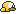

#  Flappy Bird for Mac

A native macOS Flappy Bird remake in Swift with AppKit, CoreGraphics, and AVFoundation. Flap through the gaps using Space or the left mouse button. Each pipe pair you pass earns one point. Hitting a pipe or the ground ends the round.

## Technologies

- Swift 6
- AppKit (`NSWindow`, `NSView`) and CoreGraphics
- AVFoundation (`AVAudioPlayer`)

## Build and run

Requires macOS 13+ and Swift (Xcode Command Line Tools or Xcode). Open a terminal in the repository root and run:

```zsh
swift run
```

To build a standalone `.app` bundle and launch it:

```zsh
./build-app.sh
open build/FlappyBird.app
```

To run the built-in verification checks:

```zsh
swift run FlappyBirdMac --verify
```

## Controls and rules

- **Space / Left click:** Start the round with the first flap on the **GET READY** screen. During play, press Space or click the play area to flap again.
- **Esc / Pause button:** Pause or resume the round. The orange button is in the upper-left corner. In the menu, **Resume** continues the round and **New game** returns to the ready screen with the score reset.
- **Sound: On / Off:** Toggle wing, point, and collision effects for the current session from the pause menu.
- **Play again:** After a crash, wait for the short delay and the collision sound to end. Then click **Play again**, click the play area, or press Space. With sound off, the delay is 300 ms.
- **Quit:** Press `Cmd+Q` or close the window.

From the ready screen, the bird starts in the center and slides into its usual flight position as the first pipe enters. Two pipe pairs scroll from right to left. Each gap is 120 game pixels high. Its vertical position and the horizontal spacing between pairs are randomized.

Resize the window from any edge or corner to keep the play area at a 3:4 aspect ratio. The minimum play area is 480 × 640 pixels.

## Design

`GameState` manages movement, obstacles, collision, and scoring. `GameView` handles keyboard and mouse input and updates the game on a 16 ms timer. `ArcadeRenderer` draws the scene and interface with nearest-neighbor pixel scaling.

The score resets each round. A new best score is stored in `~/Library/Application Support/FlappyBird/high-score.txt`. If the file cannot be read or saved, the game continues and shows a status message.

The background is drawn in code. The bird, pipes, and ground use bundled PNG assets. `GameAudio` manages bundled WAV effects via `AVAudioPlayer`.

The sound effects were converted to WAV from archived assets of Flappy Bird for Android v1.3 by Dong Nguyen and .GEARS Studios. [Sound archive](https://github.com/FlappyBirdRestored/flappybird-restored/tree/restored/apktool_source/assets/sounds)

## Project structure

```text
FlappyBird-for-Mac/
├── Package.swift
├── build-app.sh
├── Sources/
│   └── FlappyBirdMac/
│       ├── main.swift             # Application entry point, menu bar, and window setup
│       ├── GameView.swift         # Input, game loop, viewport scaling, and menus
│       ├── GameState.swift        # Physics, obstacles, collision, and score
│       ├── PixelRenderer.swift    # Scene, headings, score digits, and pixel buttons
│       ├── GameAudio.swift        # AVAudioPlayer sound effects and mute
│       ├── HighScoreStore.swift   # Best score persistence
│       ├── SelfTest.swift         # Built-in verification checks (--verify)
│       └── Assets/                # PNG sprites, WAV effects, and application icon
└── README.md
```
